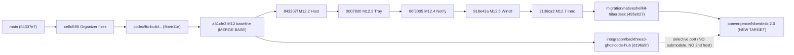

# NativeShellKit 2.0 — Multi-Repository Branch Convergence Plan

**Status:** Approved Architecture Blueprint (Planning Branch `docs/architecture-2.0`)  
**Scope:** `NativeShellKit`, `HiberDesk`, `GhostCode`, `BackThread`, and read-only boundary for `ed-local-ai`  
**Audit Date:** 2026-11-19 (UTC)

---

## 1. Verified Branch, Commit, Merge-Base, and CI Matrix

All commit hashes, parents, merge bases, and GitHub Actions statuses below were verified directly against `origin` across all five repositories.

### 1.1 Exact Branch & CI Inventory

| Repository | Branch | HEAD SHA | Parent SHA(s) | Commit Date | Subject | Latest CI Run & Status |
| --- | --- | --- | --- | --- | --- | --- |
| **NativeShellKit** | `main` | `89147f1058f853eb423624d468780aab1e064e65` | `de9a24da` | 2026-11-18 23:42 +0700 | `feat: harden DI, notification reliability, GUI installer, and CI for M11` | `44350287513` (`NativeShellKit CI`) — **PASS** |
| **NativeShellKit** | `migration/m12-sdk` | `f8f68bf7c39fef7d198ad845f2bd3d45478880a5` | `2a73d5f5` | 2026-11-19 09:31 +0700 | `Record M12 pilot and downstream compatibility checkpoints` | `44444899871` (`NativeShellKit CI`) — **PASS** (`2a73d5f5` also **PASS** `44440917801`) |
| **NativeShellKit** | `feature/ecosystem-integration-contracts` | `7c3e34c2c3208a8bd3c1d3da8331948a53551ea8` | `89147f10` | 2026-11-19 09:21 +0700 | `Authorize revocable same-user ecosystem peers` | **NO CI RUN** (branch excluded from `.github/workflows/ci.yml` push filter) |
| **HiberDesk** | `main` | `54307e79d9fd1eff60cdd4c193588389e9e221c3` | `0440f316` | 2026-11-18 15:28 +0700 | `Phase 3: OneDrive OAuth PKCE, device pairing, package-level acceptance, and sustained reliability` | `44271467595` (`HiberDesk CI`) — **FAIL** (non-portable test fixture fixed in PR #1) |
| **HiberDesk** | `codex/fix-build-and-verified-smoke-test` (Open PR #1 -> `main`) | `9bee11e34d599156d232e960b66eb43b49afa08d` | `ce8d5967` | 2026-11-18 16:23 +0700 | `Make workspace integration fixtures independent of installed apps` | `44275505753` (`HiberDesk CI`) — **PASS** |
| **HiberDesk** | `migration/nativeshellkit-hiberdesk` | `495e027f29088e4baa07e7b9b51720f5d90da339` | `21d6ca33` | 2026-11-19 09:40 +0700 | `Verify HiberDesk pilot and stabilize real-browser regression tests` | `44446100863` (`HiberDesk CI`) — **PASS** (Inno upgrade runner `44444677297` — **PASS**) |
| **HiberDesk** | `integration/backthread-ghostcode-hub` | `d196a9fc21141b45be3a1c939d1f9214d7c7b795` | `a51cfe3d` | 2026-11-19 09:56 +0700 | `Integrate the native BackThread and GhostCode companion hub` | `44447893127` (`HiberDesk CI`) — **PASS** |
| **GhostCode** | `main` (Tag `v0.1.0-beta.1`) | `4bc43e284701a25171438f342261bcd6cc484d3b` | `07c66bc6` | 2026-11-18 08:41 +0700 | `fix(ci): handle bare drive letter roots on any CWD drive and use deterministic mocked IDE assertions` | `44217711931` (`Release Windows x64`) — **PASS** |
| **GhostCode** | `migration/nativeshellkit-ghostcode` | `fa44d1a14f05ad65f3b960b93b5db97610da4ab0` | `281dcad6` | 2026-11-19 09:49 +0700 | `M12.2: adopt NativeShellKit hosting in GhostCode` | `44447166499` (`NativeShellKit migration checks`) — **PASS** |
| **GhostCode** | `integration/hiberdesk-events` | `a19742e63c550d44beeb1d20b6b2661a0674a088` | `4bc43e28` | 2026-11-19 09:33 +0700 | `Expose opt-in archive status and events to HiberDesk` | **NO CI RUN** (only tag/manual `release.yml` exists on this branch) |
| **ed-local-ai** | `main` (Tag `v0.7.5-preview` at `c385f2b`) | `e0dfea3aa7d89e2782c8b37ed8ff13f081bfcca7` | `c385f2bb` | 2026-11-11 08:20 +0700 | `docs: link portable Release downloads [skip ci]` | `42937727706` (`Windows builds` at `c385f2b`) — **PASS** |
| **ed-local-ai** | `migration/nativeshellkit-ed-local-ai` | `367cb228371306fc94bbd0bbbbd84c50d1d85c23` | `e0dfea3a` | 2026-11-19 09:20 +0700 | `Document the M12 compatibility baseline` | **NO CI RUN** (docs-only, 1 file: `M12_MIGRATION.md`) |
| **BackThread** | `master` | `9c5fdaced94aa33f7950a6ddd58a32f4c1fa08b8` | `774bf8d4` | 2026-11-18 16:45 +0000 | `Revert iOS UI to pre-Build-6 (UI2) look; keep agent/Windows features, top-bar-only notifications` | **NO CI RUN** (workflow added on `codex/native-foundation`) |
| **BackThread** | `integration/hiberdesk-bridge` | `1d6008e7f3073dcdde2a39e05f197247836803d1` | `63a0abf5` | 2026-11-19 09:55 +0700 | `Honor the host pause preference for companion handoff` | **NO CI RUN** |
| **BackThread** | `codex/companion-workbench` | `57ff8d68933050b4eaaed47ae7eef2ece6e4edd9` | `5d36a989` | 2026-11-19 02:38 +0700 | `Add scoped SSH media control, native stream diagnostics and companion job roadmap` | **NO CI RUN** |
| **BackThread** | `codex/native-foundation` | `4710def5eb17a53a183401e0e10d8322339f2f29` | `c6435ad5` | 2026-11-19 07:58 +0700 | `Isolate native job journal I/O from PCM and package build 11` | `44433272087` (`Windows regression`) — **PASS** |

---

### 1.2 Exact Merge-Base & Unique Commit Topology

#### NativeShellKit
- `merge-base(main, migration/m12-sdk)` = `89147f1` (`main`: +0, `migration/m12-sdk`: +2)
- `merge-base(main, feature/ecosystem-integration-contracts)` = `89147f1` (`main`: +0, `feature/ecosystem-integration-contracts`: +1)
- `merge-base(migration/m12-sdk, feature/ecosystem-integration-contracts)` = `89147f1` (+2 vs +1)

**Unique commits:**
- `migration/m12-sdk`:
  - `2a73d5f` — `Prepare immutable NativeShellKit alpha.2 packages for M12` (18 files: version bump `0.1.0-alpha.1` -> `0.1.0-alpha.2`, empty-dir immutability guard in `Pack-NuGet.ps1`, feed SHA verification in `Build-DeveloperKit.ps1`, `ci.yml` feed retention)
  - `f8f68bf` — `Record M12 pilot and downstream compatibility checkpoints` (`docs/migrations/M12_STATE.md`, `M12_PACKAGE_VALIDATION.json`)
- `feature/ecosystem-integration-contracts`:
  - `7c3e34c` — `Authorize revocable same-user ecosystem peers` (5 files: new `LocalPeerGrant.cs`, `sameUserPeer` / `PipeOptions.CurrentUserOnly` / 3s deadline / signed response verification in `NamedPipeIpc.cs`, `CreateSignedResponse` & overflow-safe skew check in `IpcAuthManager.cs`, unit test in `CommunicationAndModulesTests.cs`, 3 lines in `docs/DEVELOPMENT_STATE.md`)

**Overlap between SDK branches:** **1 file only** (`docs/DEVELOPMENT_STATE.md`). Zero code or public API conflicts!

#### HiberDesk
- `merge-base(main, codex/fix-build-and-verified-smoke-test)` = `54307e7` (`codex/*`: +2)
- `merge-base(migration/nativeshellkit-hiberdesk, codex/fix-build-and-verified-smoke-test)` = `9bee11e` (`migration/*` is a strict descendant of `codex/*`, +7 commits)
- `merge-base(migration/nativeshellkit-hiberdesk, integration/backthread-ghostcode-hub)` = **`a51cfe3`** (`Record M12 pilot baseline and isolated WinUI verification`)
  - `migration/nativeshellkit-hiberdesk` ahead of `a51cfe3`: **+6 commits** (`843207f` M12.2 hosting/identity, `00078d0` M12.3 tray, `86f3005` M12.4 notifications, `918e43a` M12.5 WinUI nav/theme, `21d6ca3` M12.7 Inno upgrade validation, `495e027` browser test stabilization)
  - `integration/backthread-ghostcode-hub` ahead of `a51cfe3`: **+1 commit** (`d196a9f` `Integrate the native BackThread and GhostCode companion hub`, 28 files, +1,922 / -4 lines)



#### GhostCode
- `merge-base(main, migration/nativeshellkit-ghostcode)` = `4bc43e2` (+3 commits: `c39d243`, `281dcad`, `fa44d1a` M12.2 hosting via NuGet `0.1.0-alpha.2`)
- `merge-base(main, integration/hiberdesk-events)` = `4bc43e2` (+1 commit: `a19742e` `Expose opt-in archive status and events to HiberDesk`, 10 files, +218 lines, via Git submodule `vendor/NativeShellKit` pinned to `7c3e34c`)
- `merge-base(migration/nativeshellkit-ghostcode, integration/hiberdesk-events)` = **`4bc43e2`** (+3 vs +1)

#### BackThread
- `merge-base(master, integration/hiberdesk-bridge)` = `9c5fdac` (+2 commits: `63a0abf` opt-in named pipe bridge, `1d6008e` honor host pause preference)
- `merge-base(master, codex/native-foundation)` = `6b986ce` (`master`: +8, `codex/native-foundation`: +13 including `Host.Core` split & Windows regression CI)

#### ED-Local-AI (Read-Only)
- `merge-base(main, migration/nativeshellkit-ed-local-ai)` = `e0dfea3` (+1 docs-only commit `367cb22`, `M12_MIGRATION.md` only).

---

## 2. Forensic Conflict & Architectural Divergence Audit

### 2.1 Critical Structural Conflicts Discovered

| Conflict Dimension | `migration/nativeshellkit-*` Branches | `integration/*` Branches | Architectural Diagnosis & Resolution |
| --- | --- | --- | --- |
| **SDK Consumption Mechanism** | Pinned immutable NuGet packages (`[0.1.0-alpha.2]`) via `NuGet.Config` local feed | Git submodule `vendor/NativeShellKit` (`.gitmodules`, gitlink `7c3e34c`) + direct `<ProjectReference>` to SDK `.csproj` files | **Severe Conflict.** Mixing submodule source references and NuGet packages causes diamond assembly/XBF/PRI conflicts and bypasses versioned package boundaries. **Resolution:** Delete `.gitmodules` and `vendor/NativeShellKit`; consume `NativeShellKit.*` **exclusively via NuGet** (`0.2.0-alpha.1+`). |
| **Application Host & DI Container** | HiberDesk `App.xaml.cs` builds **one** `NativeShellHost` (`HostRegistryBridge.PopulateFrom(registry, services)`) serving as `_serviceProvider` | `EcosystemRuntime.cs` builds a **second** `NativeShellHost` (with separate `ServiceContainer`) while `App.xaml.cs` still runs legacy `services.BuildServiceProvider()` | **Critical Architectural Defect.** Merging blindly would create TWO parallel `NativeShellHost` instances and TWO `ServiceContainer`s in one process. **Resolution:** Eliminate `EcosystemRuntime`'s private `NativeShellHost`; register `BackThreadIntegrationModule` and `GhostCodeIntegrationModule` on HiberDesk's single canonical `NativeShellHost`. |
| **Notification Service Duplication** | HiberDesk `App.xaml.cs` registers canonical `AddUnifiedNotifications(...)` on the primary host; `MainViewModel` publishes to `INotificationService`; `MainWindow` renders `SdkBanner` | `EcosystemRuntime.cs` calls `.AddUnifiedNotifications()` a second time inside its private host, writing a duplicate history file under `%LOCALAPPDATA%\HiberDesk\ecosystem\trungduc22\hiberdesk\` and duplicating `PublishAsync` calls in `MainViewModel.cs` lines 863 & 1035 | **Critical Duplication.** Both branches added `INotificationService.PublishAsync` calls in `MainViewModel.SaveCurrentSessionAsync()` and `SyncNowAsync()` with conflicting schemas (`workspace` vs `Workspaces`, `sync` vs `Devices`). **Resolution:** One `INotificationService`; `NotificationRelayService` subscribes directly to the canonical `INotificationService.InAppNotificationRaised` (or typed `IInProcessEventBus` event) — zero duplicate `PublishAsync` calls in `MainViewModel`. |
| **Theme & XAML Resources** | HiberDesk `migration` deleted `Themes/HiberThemePalette.cs` and all `Hiber*Brush` static resources from `App.xaml`, switching all 7 pages to `{ThemeResource NativeShell*}` + `WinUiThemeService` | `integration` retained `HiberThemePalette.cs` + `Hiber*Brush` in `App.xaml` AND added `<design:DesignSystemThemeResources />` alongside them; `DevicesPage.xaml` still references `HiberMutedTextBrush` | **Direct Merge Conflict** in `App.xaml`, `DevicesPage.xaml`, `OverviewPage.xaml`. **Resolution:** Keep `migration`'s removal of `HiberThemePalette.cs`; port `CompanionPanel` and `OverviewPage` ecosystem card using canonical NativeShellKit 2.0 `{ThemeResource Nsk*}` / `DesignSystemThemeResources` only. |
| **Tray & Window Lifecycle** | HiberDesk `migration` refactored `TrayIconManager.cs` (-368/+lines) onto `NativeTrayService`, adopted `ShellWindowService` + `WinUiNavigationService` + `WinUiThemeService` in `MainWindow.xaml.cs` | `integration` kept legacy 368-line Win32 `TrayIconManager` and legacy `MainWindow.xaml.cs` | **Must NOT revert M12.** Keep `migration/nativeshellkit-hiberdesk` (`495e027`) as the base branch so M12.2–M12.7 tray, theme, navigation, and Inno validation stay intact. |
| **GhostCode `App.xaml.cs` & `.csproj`** | `fa44d1a` replaces `_serviceProvider = services.BuildServiceProvider()` with `NativeShellHostBuilder` + NuGet `NativeShellKit.Hosting` & `Diagnostics` `[0.1.0-alpha.2]` | `a19742e` keeps legacy `ServiceProvider`, adds `vendor/NativeShellKit` `ProjectReference` to `NativeShellKit.Communication`, wires `HiberDeskPeer` static property on `App` | **Clean Conflict.** Keep `migration/nativeshellkit-ghostcode` (`fa44d1a`) as base; add `PackageReference Include="NativeShellKit.Communication" Version="[0.2.0-alpha.1]"` and register `HiberDeskPeer` as a DI-managed `IShellModule` / singleton instead of `internal static HiberDeskPeer? CompanionPeer`. |

### 2.2 File-Level Conflict Matrix

| Repository | Overlapping Files Between Diverged Branches | Conflict Resolution Strategy |
| --- | --- | --- |
| **NativeShellKit** | `docs/DEVELOPMENT_STATE.md` (1 file) | Combine both milestone notes; advance version to `0.2.0-alpha.1` |
| **HiberDesk** | `.github/workflows/build-and-test.yml`, `src/HiberDesk.App/App.xaml`, `src/HiberDesk.App/App.xaml.cs`, `src/HiberDesk.App/Diagnostics/UiSelfTestRunner.cs`, `src/HiberDesk.App/HiberDesk.App.csproj`, `src/HiberDesk.App/ViewModels/MainViewModel.cs`, `src/HiberDesk.App/Views/DevicesPage.xaml`, `src/HiberDesk.App/Views/OverviewPage.xaml` (8 files) | Base on `495e027` (`migration/nativeshellkit-hiberdesk`); port `HiberDesk.Integrations.BackThread`, `GhostCodeConnection`, `CompanionViewModel`, `CompanionPanel`, `BackThreadBridgeTests`, `packaging/HiberDesk.iss` optional task, and UI self-test additions cleanly without reverting M12 or introducing submodules/second host |
| **GhostCode** | `src/GhostCode.App/App.xaml.cs`, `src/GhostCode.App/GhostCode.App.csproj` (2 files) | Base on `fa44d1a` (`migration/nativeshellkit-ghostcode`); add `HiberDeskPeer` (DI-registered), `NotificationCoordinator.NotificationEligible`, `SettingsPage` access control, and `NativeShellKit.Communication` NuGet reference |
| **BackThread** | No conflict with NativeShellKit (zero SDK dependency). Internal divergence between `master` (`9c5fdac`) and `codex/native-foundation` (`4710def`) | BackThread team retains ownership. Port `integration/hiberdesk-bridge` commits (`63a0abf`, `1d6008e`) onto BackThread's stabilized Windows branch without adding any NativeShellKit reference |

---

## 3. Recommended Canonical SDK Baseline

1. **Canonical Version:** **`0.2.0-alpha.1`** (new immutable prerelease — **NEVER reuse `0.1.0-alpha.1` or `0.1.0-alpha.2`**).
2. **Baseline Ancestry:**
   - Start from `NativeShellKit/migration/m12-sdk` (`f8f68bf7c39fef7d198ad845f2bd3d45478880a5`), which already includes all M11 hardening (`89147f1`), immutable package packing validation, and M12 checkpoints.
   - Merge `NativeShellKit/feature/ecosystem-integration-contracts` (`7c3e34c2c3208a8bd3c1d3da8331948a53551ea8`) to bring in `LocalPeerGrant`, `PipeOptions.CurrentUserOnly`, signed response verification (`CreateSignedResponse`), and `MessageId` correlation.
   - Add the **Platform 2.0 Canonical Host** changes (`docs/architecture/PLATFORM_2_0.md` — MEDI-backed `NativeShellHost`, `ITrayService`, `IUiDispatcher`, `ILocalPeerGrant`, multi-targeted `Abstractions`/`Hosting`, dynamic `Directory.Build.props` version sourcing, and `ci.yml` branch-trigger fix so feature/convergence branches run CI).
3. **Immutable Feed Enforcement:**
   - Every SDK milestone publishes to a fresh, non-reused directory with `SHA256SUMS.txt` and `feed-manifest.json`.
   - `0.1.0-alpha.2` remains archived/frozen for M12 rollback verification only.

---

## 4. Exact Branch Convergence Sequence

Do **NOT** merge application branches directly into `main` until the converged branch passes full CI, isolated WinUI self-tests, Inno upgrade/rollback verification, and dual-app peer tests.

### Step 1 — Converge `NativeShellKit` (Produces `0.2.0-alpha.1`)
```bash
# Inside NativeShellKit
git checkout -b convergence/sdk-2.0 origin/migration/m12-sdk
git merge --no-ff origin/feature/ecosystem-integration-contracts
# Resolve single trivial conflict in docs/DEVELOPMENT_STATE.md
# Merge docs/architecture-2.0 planning docs
# Implement M13 (Canonical Host + Abstractions multi-target + LocalPeerGrant hardening + version 0.2.0-alpha.1)
# Run Pack-NuGet.ps1 + full Release x64 build + xUnit tests + sample self-tests + template verification
```
**Gate:** All NativeShellKit CI jobs green on `convergence/sdk-2.0`; 13 immutable `0.2.0-alpha.1` `.nupkg` artifacts verified with SHA-256 manifest.

### Step 2 — Converge `HiberDesk` (Built on Verified M12 Baseline `495e027`)
```bash
# Inside HiberDesk
# Optional prerequisite: merge PR #1 (9bee11e) to main is ALREADY contained in 495e027.
git checkout -b convergence/hiberdesk-2.0 origin/migration/nativeshellkit-hiberdesk
```
**Selective Port Plan from `origin/integration/backthread-ghostcode-hub` (`d196a9f`):**

| Source Item in `d196a9f` | Action | Specific Integration Rule |
| --- | --- | --- |
| `.gitmodules`, `vendor/NativeShellKit` | **REJECT** | Never add Git submodules; consume `NativeShellKit.*` `[0.2.0-alpha.1]` via NuGet |
| `src/HiberDesk.Integrations.BackThread/*` | **PORT VERBATIM** | Pure `net10.0` bridge library; zero SDK/WinUI coupling; add to `HiberDesk.sln` |
| `tests/HiberDesk.Integration.Tests/BackThreadBridgeTests.cs` | **PORT** | Keep all bridge protocol, auth, and pause-veto tests |
| `src/HiberDesk.App/Integrations/GhostCodeConnection.cs` | **PORT & HARDEN** | Consume `LocalPeerGrant` from NuGet `NativeShellKit.Communication` `0.2.0-alpha.1`; move polling onto `IBackgroundTaskSupervisor` and cache `IpcAuthManager` |
| `src/HiberDesk.App/Integrations/EcosystemRuntime.cs` | **REWRITE (DO NOT PORT SECOND HOST)** | Split into `EcosystemSettingsStore`, `CompanionRelayService` (subscribing to canonical `INotificationService`), `BackThreadIntegrationModule`, and `GhostCodeIntegrationModule` registered on HiberDesk's single `NativeShellHost` |
| `src/HiberDesk.App/ViewModels/CompanionViewModel.cs` | **PORT & WIRE VIA DI** | Inject `BackThreadConnection`, `GhostCodeConnection`, `CompanionRelayService`, `IUiDispatcher` from canonical `IServiceProvider` (remove `App.Ecosystem!` static locator) |
| `src/HiberDesk.App/Views/CompanionPanel.xaml(.cs)` | **PORT & UPGRADE** | Replace legacy styles with NativeShellKit 2.0 `DesignSystem` tokens (`CompactMediaBar` in M15); keep bilingual En/Vi labels & UIA properties |
| `src/HiberDesk.App/Views/OverviewPage.xaml(.cs)`, `DevicesPage.xaml(.cs)` | **PORT CLEANLY** | Preserve M12 `{ThemeResource NativeShell*}` (no `HiberMutedTextBrush` regression!); wire via DI and `ModuleCardBoundary` |
| `src/HiberDesk.App/ViewModels/MainViewModel.cs` | **REJECT DUPLICATE PUBLISH** | Keep M12.4 `INotificationService.PublishAsync` calls; ensure metadata tags (`category`, `sourceModuleId`) satisfy `CompanionRelayService` filter policy without emitting duplicate notifications |
| `packaging/HiberDesk.iss` | **PORT** | Keep optional `#ifdef CompanionHostDir` task (`backthreadhost`) while preserving `AppId={{A8F4D2E1-6C59-4E3A-9B72-7F1B8D3C2E90}` |
| `src/HiberDesk.App/Diagnostics/UiSelfTestRunner.cs` | **MERGE** | Combine M12.5 SDK banner/theme checks + companion panel acceptance checks |

**Gate:** `HiberDesk CI` green (Core tests + Integration + `BackThreadBridgeTests` + Real browser tests + Isolated WinUI self-test + 10-step Inno install/upgrade/rollback verification).

### Step 3 — Converge `GhostCode` (Built on Verified M12 Baseline `fa44d1a`)
```bash
# Inside GhostCode
git checkout -b convergence/ghostcode-2.0 origin/migration/nativeshellkit-ghostcode
```
**Selective Port Plan from `origin/integration/hiberdesk-events` (`a19742e`):**
- **REJECT** `.gitmodules` and `vendor/NativeShellKit`.
- **UPGRADE** `NativeShellKit.Hosting` and `NativeShellKit.Diagnostics` from `[0.1.0-alpha.2]` to `[0.2.0-alpha.1]`, and **ADD** `NativeShellKit.Communication` `[0.2.0-alpha.1]`.
- **PORT** `NotificationCoordinator.NotificationEligible`, `HiberDeskPeer.cs` (wrapped as `IShellModule` registered on GhostCode's single `NativeShellHost`, using `IUiDispatcher` instead of manual `TaskCompletionSource` + `DispatcherQueue`), `SettingsPage` HiberDesk access toggle, and `docs/HIBERDESK_PEER.md`.
- **ADD** CI workflow trigger for `convergence/*` and `migration/*` so GhostCode runs automated build, unit, peer-IPC, and isolated GUI checks on every push.

### Step 4 — Stabilize `BackThread` Bridge (Independent)
- BackThread keeps zero dependency on NativeShellKit.
- Add `integration/hiberdesk-bridge` commits (`63a0abf`, `1d6008e`) onto BackThread's active Windows target branch (`codex/native-foundation` or `master` per BackThread's release decision), and enable `Windows regression` CI on it.

### Step 5 — Protect `ed-local-ai` (Frozen During Convergence)
- **Zero edits** to `ed-local-ai/main` or `ed-local-ai/migration/nativeshellkit-ed-local-ai` during NativeShellKit 2.0, HiberDesk, and GhostCode convergence. See `docs/migration/ECOSYSTEM_ROADMAP.md` §5 for post-stabilization adoption criteria.

---

## 5. Persistent Identity, Storage, and Upgrade Risk Preservation

Convergence **MUST NOT** alter any persisted user path, encryption key/entropy, registry key, or installer identity:

| Product | Data Root & SQLite | Secrets / DPAPI | Windows Startup & Single-Instance | Browser / External IPC & Installer `AppId` |
| --- | --- | --- | --- | --- |
| **HiberDesk** | `%LOCALAPPDATA%\HiberDesk\config.json` + configured SQLite WAL DB. SDK metadata isolated under `<dataDir>\trungduc22\hiberdesk\`. | Existing HiberDesk `DpapiSecretStore` under `<dataDir>\secrets` (original format & entropy). | Run value `HiberDesk` (`--background`). Mutex `Local\HiberDesk_SingleInstance_Mutex_v1`, Pipe `HiberDesk_SingleInstance_Pipe_v1`. | Native host `com.hiberdesk.nativehost`, Pipe `HiberDesk_NativeBridge_v1`. Inno `AppId={{A8F4D2E1-6C59-4E3A-9B72-7F1B8D3C2E90}`. |
| **GhostCode** | Existing configured archive root, catalog, `credentials.dpapi`, and SQLite WAL DB. SDK metadata isolated under `<dataDir>\trungduc22\ghostcode\`. | `GhostCode.OAuth.DPAPI.v1` and `GhostCode.OAuthClientSecret.DPAPI.v1`. | Existing startup/activation behavior preserved. | Native host `com.ghostcode.bridge`. Peer grant identity `trungduc22 / ghostcode-hiberdesk-v1`. Inno `AppId={{8F9C31E2-7C2A-4D4B-9D8F-2B9E6C41A010}`. |
| **BackThread** | Existing `config/local.json`, `config/session.key`, Spotify tokens, `%LOCALAPPDATA%\BackThread\runtime\{usb|localhost-<port>}.lock`. | 32-byte `session.key` (raw key never sent over HiberDesk pipe; HMAC-SHA256 derived bearer only). | Standalone CLI/Tray host; optional `--hiberdesk` flag. | Pipe `BackThread.HiberDesk.v1.<SID>.<port>` (`X-BackThread-Bridge: 1`), TCP loopback `23452`, BTH1 USB wire protocol unchanged. |
| **ED-Local-AI** *(Frozen)* | Main: `%LOCALAPPDATA%\EDLocalAI\data`. Practice Fast: `%LOCALAPPDATA%\EDLocalAI-PracticeFast\data` (with first-run one-way copy from Main). | `native-auth.dpapi` (DPAPI `CurrentUser`, `null` entropy). | Mutex `EDLocalAI.Native.<user>` and `EDLocalAI.PracticeFast.<user>`. | Portable single-file x64 executables (`ED-Local-AI.exe`, `ED-Local-AI-Practice-Fast.exe`). |

---

## 6. Rollback Guarantees

1. **NativeShellKit:** Because `0.2.0-alpha.1` is immutable and never overwrites `0.1.0-alpha.2`, any consumer can roll back instantly by re-pinning `[0.1.0-alpha.2]` against the archived M12 feed (`2a73d5f`).
2. **HiberDesk:** Roll back to verified M12 pilot `495e027` (or pre-SDK baseline `9bee11e`) using its matching Inno Setup installer. Config JSON, SQLite WAL database, and DPAPI secrets remain byte-compatible; optional `<dataDir>\ecosystem\settings.json` and `<dataDir>\trungduc22\hiberdesk\` metadata are ignored safely by older binaries.
3. **GhostCode:** Roll back to `fa44d1a` (M12.2) or `v0.1.0-beta.1` (`4bc43e2`). Revoking or deleting the `ghostcode-hiberdesk-v1` DPAPI grant cleanly disables peer IPC with zero impact on archives or cloud sync.
4. **BackThread:** Set `"enableHiberDeskBridge": false` (or omit `--hiberdesk`) to disable the named pipe immediately; zero impact on USB/iOS/PCM audio or standalone TCP API.
