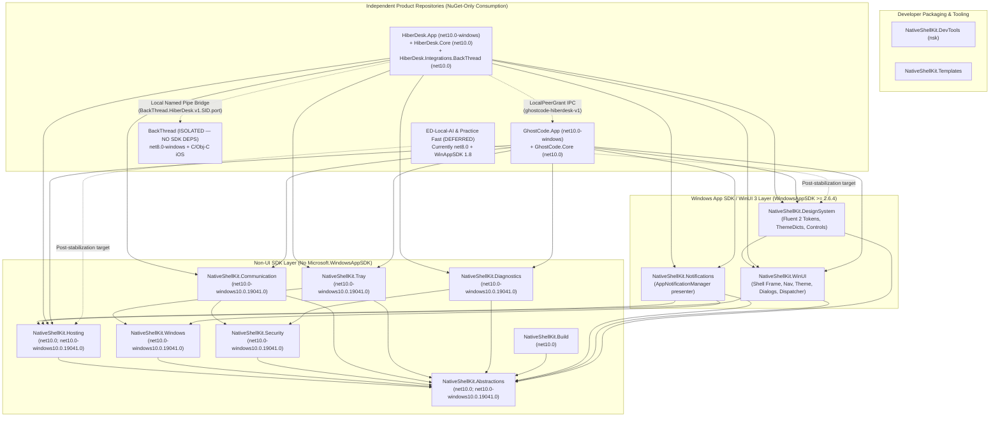

# NativeShellKit 2.0 — SDK Package Coherence & Dependency Graph

**Status:** Approved Architecture Blueprint (`docs/architecture-2.0`)  
**Target Canonical Prerelease:** `0.2.0-alpha.1` (Host/Contracts Convergence) -> `0.2.0-alpha.2` (UI/UX 2.0) -> `0.2.0-beta.1` (Dual-App Release Candidate)

---

## 1. Ecosystem Dependency Graph

---

## 2. Package Boundary & Coherence Audit

The table below reflects the actual `.csproj` files audited in `NativeShellKit` (`origin/main` + `migration/m12-sdk` + `feature/ecosystem-integration-contracts`) alongside required 2.0 coherence fixes.

| Package ID | Current TFM (`0.1.0-alpha.2`) | Target TFM (`0.2.0-alpha.1`) | External NuGet Dependencies | WinUI / XAML? | Required 2.0 Coherence Fixes |
| --- | --- | --- | --- | --- | --- |
| `NativeShellKit.Abstractions` | `net10.0-windows10.0.19041.0` | **`net10.0;net10.0-windows10.0.19041.0`** | `Microsoft.Extensions.DependencyInjection.Abstractions` (`>= 10.0.0`) | No | Multi-target to `net10.0` (verified zero Windows-specific `using`s!) so `HiberDesk.Core` & `GhostCode.Core` can reference contracts directly. Formalize MEDI.Abstractions exception in `AGENTS.md` (ADR-005). Add missing canonical interfaces: `ITrayService`, `IUiDispatcher`, `IStartupService`, `ISingleInstanceService`, `ILocalPeerGrantFactory`, `INavigationAware`, `IModuleWidgetProvider`. |
| `NativeShellKit.Hosting` | `net10.0-windows10.0.19041.0` | **`net10.0;net10.0-windows10.0.19041.0`** | `Microsoft.Extensions.DependencyInjection` (`>= 10.0.0`) | No | Multi-target to `net10.0` (verified zero Windows-specific `using`s!). Replace custom `ServiceContainer` lock-across-ctor implementation with MEDI `ServiceProvider` backing (ADR-004). |
| `NativeShellKit.Windows` | `net10.0-windows10.0.19041.0` | `net10.0-windows10.0.19041.0` | `Microsoft.Win32.SystemEvents` (`>= 10.0.0`) | No | Implement `IStartupService` and `ISingleInstanceService` with `LegacyIdentityOverrides` support (custom Run value name, custom args `--background`, custom Mutex/Pipe names). |
| `NativeShellKit.Security` | `net10.0-windows10.0.19041.0` | `net10.0-windows10.0.19041.0` | `System.Security.Cryptography.ProtectedData` (`>= 10.0.0`) | No | Merge `IpcAuthManager.CreateSignedResponse` + overflow-safe timestamp skew check from `7c3e34c`; add bounded replay-nonce cache (TTL = `2 * maxClockSkew`) to prevent intra-window replay. |
| `NativeShellKit.Communication` | `net10.0-windows10.0.19041.0` | `net10.0-windows10.0.19041.0` | *(SDK refs: Abstractions, Security)* | No | Merge `LocalPeerGrant` + `sameUserPeer` (`PipeOptions.CurrentUserOnly`, `TokenImpersonationLevel.Identification`, 3s request deadline, mutual HMAC response verification) from `7c3e34c`. Add `ILocalPeerGrant` interface and cached `IpcAuthManager` handle with revocation detection to avoid per-poll DPAPI disk reads. |
| `NativeShellKit.Tray` | `net10.0-windows10.0.19041.0` | `net10.0-windows10.0.19041.0` | *(SDK refs: Abstractions, Windows)* | No | Have `NativeTrayService` implement canonical `ITrayService` and expose `AddNativeTray()` host builder extension (eliminating manual `new NativeTrayService(identity)` inside consumer `MainWindow`). |
| `NativeShellKit.Diagnostics` | `net10.0-windows10.0.19041.0` | `net10.0-windows10.0.19041.0` | `System.Drawing.Common` (`>= 10.0.0`) | No | Keep WinUI-free; add structured performance budget assertions (startup, frame, worker count, memory delta) to `DiagnosticsService`. |
| `NativeShellKit.Notifications` | `net10.0-windows10.0.19041.0` | `net10.0-windows10.0.19041.0` | `Microsoft.WindowsAppSDK` (`>= 2.6.4`) | WindowsAppSDK only (no XAML) | Coalesce/debounce `JsonNotificationHistoryStore` writes (currently rewrites entire file on every notification/mark-read). Ensure `AddUnifiedNotifications` never registers duplicate instances. Consider splitting headless `Notifications.Core` only if a non-WindowsAppSDK app needs `UnifiedNotificationService` later (not required now since BackThread stays SDK-free). |
| `NativeShellKit.WinUI` | `net10.0-windows10.0.19041.0` | `net10.0-windows10.0.19041.0` | `Microsoft.WindowsAppSDK` (`>= 2.6.4`) | **Yes (WinUI 3 XAML)** | Implement `IUiDispatcher`, unified `NativeShellFrame` (5 shell variants), `ShellTitleBar` with automatic `InputNonClientPointerSource` passthrough rects, view caching + `INavigationAware`, and fixed `buildTransitive` publish targets. |
| `NativeShellKit.DesignSystem` | `net10.0-windows10.0.19041.0` | `net10.0-windows10.0.19041.0` | `Microsoft.WindowsAppSDK` (`>= 2.6.4`) | **Yes (WinUI 3 XAML)** | Full Fluent 2 UI/UX 2.0 token system (`Light`/`Dark`/`HighContrast`), `Themes/Generic.xaml` templated controls, 100% `DependencyProperty`-backed APIs, `CompactMediaBar`, `ModuleCardBoundary`, fixed `buildTransitive` publish targets. |
| `NativeShellKit.Build` | `net10.0-windows10.0.19041.0` | **`net10.0`** | *(SDK ref: Abstractions)* | No | Keep cross-platform for CI validation; add automated check that no consumer `.csproj` references `vendor/NativeShellKit` and that all `NativeShellKit.*` versions match. |
| `NativeShellKit.DevTools` | `net10.0-windows10.0.19041.0` | `net10.0-windows10.0.19041.0` | *(Tool package `nsk`)* | No | Remove hardcoded fallback version string (`"0.1.0-alpha.2"` -> read assembly metadata only). |
| `NativeShellKit.Templates` | Content-only template pack | Content-only template pack | None | Template | Generate template version from `Directory.Build.props` at pack time; update template `App.xaml.cs` to showcase canonical `NativeShellHost` + `NativeShellFrame` 2.0. |

---

## 3. Identified Packaging & Build Defects to Fix in `0.2.0-alpha.1`

### 3.1 Single Source of Truth for Version Synchronization
In `0.1.0-alpha.2`, the version string was hardcoded across **12 separate files** (`Directory.Build.props`, `Pack-NuGet.ps1`, `Build-DeveloperKit.ps1`, `DeveloperKit.iss`, `.github/workflows/ci.yml`, 3 sample `.csproj`s, `NativeShellKitApp.csproj`, `DevTools/Program.cs`, `GuiInstallerForm.cs`, `InstallerEngine.cs`).

**2.0 Mandate:**
1. **`Directory.Build.props`** is the **single authoritative source** for `<Version>`, `<InformationalVersion>`, `<AssemblyVersion>`, and `<FileVersion>`.
2. `Pack-NuGet.ps1` and `Build-DeveloperKit.ps1` read `<Version>` directly from `Directory.Build.props` when `-Version` is omitted, and fail fast if an explicit `-Version` mismatches.
3. `ci.yml` reads `<Version>` dynamically instead of hardcoding `NativeShellKit.Templates.0.1.0-alpha.2.nupkg` or `NativeShellKit-feed-alpha2`, and triggers on `branches: [ main, "convergence/*", "migration/*", "feature/*", "release/*" ]` plus `pull_request`.
4. `DeveloperKit.iss` receives `/DAppVersion=<version>` from `Build-DeveloperKit.ps1`.
5. `GuiInstallerForm.cs`, `InstallerEngine.cs`, and `DevTools/Program.cs` read `AssemblyInformationalVersionAttribute` without stale fallback literals.

### 3.2 WinUI `.xbf`, `.pri`, and `Themes/Generic.xaml` Packaging Targets
Current `src/NativeShellKit.WinUI/buildTransitive/NativeShellKit.WinUI.targets` and `NativeShellKit.DesignSystem.targets` have two subtle fragility points:
1. They hardcode `..\lib\net10.0-windows10.0.19041\...` and copy files in `AfterTargets="Build;Publish"` **after** `ComputeFilesToPublish` has already computed `ResolvedFileToPublish`. Under `dotnet publish` / Inno staging / single-file staging, files copied only in `AfterTargets="Publish"` can be omitted from manifest-driven bundlers or require consumers to maintain custom `IncludeCompiledXamlInPublish` hacks.
2. When `DesignSystem` introduces `TemplatedControl` styles in `Themes\Generic.xaml`, WinUI resolves `ms-appx:///NativeShellKit.DesignSystem/Themes/Generic.xaml` from both the merged `.pri` index and `<AssemblyName>\Themes\Generic.xbf`.

**2.0 Fix:**
- Keep `IncludeWinUiXbfInPack` packaging `**\*.xbf` (including `Themes\Generic.xbf`) and `$(AssemblyName).pri` under `lib\$(_NuGetShortTfm)\$(AssemblyName)\`.
- In `buildTransitive\<PackageId>.targets`:
  - Copy `.xbf` into `$(OutDir)<AssemblyName>\` on `AfterTargets="Build"`.
  - Hook **`BeforeTargets="ComputeFilesToPublish"`** (in addition to `AfterTargets="Publish"`) to inject `@(_Nsk*Xbf)` into `ResolvedFileToPublish` with `<RelativePath><AssemblyName>\%(RecursiveDir)%(Filename)%(Extension)</RelativePath>` and `<CopyToPublishDirectory>PreserveNewest</CopyToPublishDirectory>`.
- Extend `Pack-NuGet.ps1` validation step `[3/3]` to assert that `NativeShellKit.DesignSystem.*.nupkg` contains `Themes/Generic.xbf`, `Themes/DesignSystemThemeResources.xbf`, and `NativeShellKit.DesignSystem.pri`, and that an external clean-consumer `dotnet publish` (unpackaged x64) produces every `.xbf` in the published output directory.

### 3.3 Windows App SDK & .NET Package Compatibility Matrix

| Dependency | NativeShellKit `0.2.0-alpha.1` Floor | HiberDesk (`convergence/hiberdesk-2.0`) | GhostCode (`convergence/ghostcode-2.0`) | ED-Local-AI (Deferred Future) | Resolution Behavior |
| --- | --- | --- | --- | --- | --- |
| **.NET Runtime / TFM** | `net10.0` (core) / `net10.0-windows10.0.19041.0` (Windows/UI) | `net10.0` (`Core`, `Integrations.BackThread`) + `net10.0-windows10.0.19041.0` (`App`) | `net10.0` (`Core`) + `net10.0-windows10.0.19041.0` (`App`) | Currently `net8.0-windows10.0.19041.0` -> Future `net10.0-windows10.0.19041.0` | Exact match for HiberDesk & GhostCode; clean upgrade gate for ED-Local-AI |
| **Microsoft.WindowsAppSDK** | `2.6.4` (SDK lower bound in `Directory.Packages.props`) | `2.6.5` (direct `PackageReference`) | `2.6.5` (direct `PackageReference`) | Currently `1.8.260921001` -> Future `>= 2.6.5` | NuGet minimal-version rule cleanly unifies upward to `2.6.5` (verified in M12) |
| **Microsoft.Extensions.DependencyInjection(.Abstractions)** | `10.0.0` | `11.0.0` | `11.0.0` | None currently | NuGet rolls forward cleanly to `11.0.0` (verified in M12) |
| **System.Security.Cryptography.ProtectedData** | `10.0.0` | `11.0.0` | `11.0.0` | `8.0.0` -> Future `>= 10.0.0` | Clean upward roll-forward |
| **CommunityToolkit.Mvvm** | Not required by SDK (`MvvmPrimitives` optional) | `8.4.0` (kept for app ViewModels) | `8.4.0` (kept for app ViewModels) | Optional | Zero conflict; apps may keep `CommunityToolkit.Mvvm` while adopting `DesignSystem` |
| **CommunityToolkit.WinUI.Controls.SettingsControls** | Not required by SDK | `8.2.251219` (gradually replaceable by `DesignSystem` `SettingsRow`/`SettingsSection` 2.0) | `8.2.251219` (gradually replaceable) | Not used | Optional removal after Settings pages migrate to `DesignSystem` 2.0 |

---

## 4. NuGet-Only Consumption & Feed Governance

1. **Submodule Prohibition:** Consumer repositories (`HiberDesk`, `GhostCode`, future `ED-Local-AI`) **MUST NEVER** mount `NativeShellKit` as a Git submodule (`vendor/NativeShellKit`) or use `<ProjectReference>` across repository boundaries.
2. **Exact Version Pinning in Consumers:** All `NativeShellKit.*` `PackageReference`s inside a consumer `.csproj` MUST pin the exact same immutable prerelease version (e.g., `Version="[0.2.0-alpha.1]"` via a shared `<NativeShellKitVersion>` property in the consumer's `Directory.Build.props`) so transitive `Abstractions`, `Hosting`, `WinUI`, and `DesignSystem` assemblies and `.xbf` assets can never drift out of sync.
3. **Immutable Prerelease Progression:**
   - `0.1.0-alpha.1` — Historical M11 `main` baseline (frozen).
   - `0.1.0-alpha.2` — Historical M12 pilot baseline (frozen; never overwritten).
   - **`0.2.0-alpha.1`** — Converged SDK: M12 + `LocalPeerGrant` + MEDI-backed Canonical Host + multi-targeted `Abstractions`/`Hosting` + `ITrayService`/`IUiDispatcher`/`IStartupService`/`ISingleInstanceService` + fixed `buildTransitive` targets.
   - **`0.2.0-alpha.2`** — Native UI/UX 2.0: Fluent 2 semantic tokens (`Light`/`Dark`/`HighContrast`), `NativeShellFrame` 5 shell variants, 100% `DependencyProperty`-backed controls, `CompactMediaBar`, `ModuleCardBoundary`.
   - **`0.2.0-beta.1`** — Dual-app verified release candidate (HiberDesk + GhostCode converged + cross-app coexistence + Inno upgrade/rollback verified).
   - **`0.2.0`** — First stable converged platform release (only published with explicit user authorization).
4. **CI Verification Pattern for Unreleased Prereleases:** Consumer CI workflows (like HiberDesk `.github/workflows/build-and-test.yml` and GhostCode `m12-migration.yml`) check out the exact pinned `NativeShellKit` commit SHA, pack into a clean local feed directory (`artifacts/sdk-feed`), verify `feed-manifest.json` SHA-256 hashes, and restore via `NuGet.Config` package source mapping (`NativeShellKit.*` -> local feed; everything else -> `nuget.org`).
