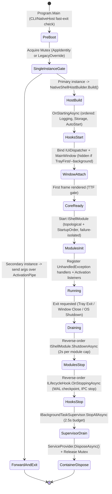

# NativeShellKit 2.0 — Unified Platform & Canonical Application Host Architecture

**Status:** Approved Architecture Blueprint (`docs/architecture-2.0`)  
**Scope:** Canonical Composition Root, Module Lifecycle, Security/IPC Planes, Identity Compatibility, and Measurable Performance Architecture

---

## 1. Ecosystem Architecture Charter

The Windows native application ecosystem consists of **five independent repositories** that MUST remain separate products and codebases:

| Repository | Role | Runtime / UI Stack | Relationship to NativeShellKit |
| --- | --- | --- | --- |
| **NativeShellKit** | Shared native Windows platform SDK & Fluent 2 Design System | `.NET 10`, WinUI 3 / Windows App SDK `>= 2.6.4`, Win32 interop | Authoritative platform delivered exclusively as synchronized immutable NuGet packages (`0.2.0-*`) |
| **HiberDesk** | Unified productivity & workspace command center | `.NET 10`, WinUI 3 (`App`) + `net10.0` (`Core`, `Integrations.BackThread`) | Primary `ModuleHost` / `Dashboard` / `TrayFirst` consumer; orchestrates optional BackThread & GhostCode companion modules |
| **GhostCode** | Independent developer archive, diff & cloud-sync engine | `.NET 10`, WinUI 3 (`App`) + `net10.0` (`Core`) | Independent `Dashboard` / `TrayFirst` consumer; exposes opt-in revocable `LocalPeerGrant` server to HiberDesk |
| **ED-Local-AI** | Independent English Discoveries assistant (Main WinUI + Practice Fast) | Currently `.NET 8`, Windows App SDK `1.8.260921001` (Frozen during active bug fixes) | Future `CompactUtility` shell consumer post-stabilization; never blocks NativeShellKit/HiberDesk convergence |
| **BackThread** | Independent USB, iOS companion, WASAPI/PCM audio & Hybrid MediaRouter engine | `.NET 8` Windows host (`Host.Core`/`Host`/`Tray`) + native C/Obj-C iOS | **Zero NativeShellKit dependency.** Exposes opt-in same-user local named pipe (`BackThread.HiberDesk.v1.<SID>.<port>`) |

---

## 2. Problem Analysis: Why Current Hosting Must Be Rebuilt

Direct inspection of `NativeShellKit` (`origin/main`) and `HiberDesk` (`integration/backthread-ghostcode-hub` vs `migration/nativeshellkit-hiberdesk`) exposed **four concrete foundational defects**:

1. **Dual Parallel Hosts in HiberDesk Integration (`EcosystemRuntime.cs`):**
   - `HiberDesk [integration/backthread-ghostcode-hub] src/HiberDesk.App/Integrations/EcosystemRuntime.cs` instantiates its own private `NativeShellHost` + `ServiceContainer` + `AddUnifiedNotifications()` under `<dataDir>\ecosystem\trungduc22\hiberdesk\`, while `App.xaml.cs` maintains a separate `ServiceProvider` and legacy tray/theme/lifecycle stack.
   - Merging this into M12 without redesigning the composition root would produce **two `NativeShellHost` instances, two DI containers, and two `UnifiedNotificationService` history stores** in one process.
2. **Custom `ServiceContainer` Concurrency & Ownership Hazards (`ServiceContainer.cs`):**
   - `ServiceContainer.GetServiceInternal` (`src/NativeShellKit.Hosting/DependencyInjection/ServiceContainer.cs:164-198`) holds `lock (_sync)` **across constructor reflection (`ctor.Invoke(args)`) and delegate factory invocations (`descriptor.Factory(...)`)**. Any constructor or factory that triggers cross-thread resolution deadlocks the entire container.
   - `ServiceContainer.ScopeBucket` (`line 373`) does **not** enforce captive-dependency validation: resolving a `Scoped` service from the root `IServiceProvider` silently succeeds and pins it for process lifetime.
   - Unregistered concrete types instantiated via `CreateInstance` (`line 195`) bypass `TrackDisposableIfOwned`, leaking `IDisposable` resources.
   - Paradoxically, `NativeShellKit.Hosting` **already depends on `Microsoft.Extensions.DependencyInjection` `10.0.0`**, yet bypasses its battle-tested `ServiceProvider` in favor of the hand-rolled `ServiceContainer`.
3. **Missing Canonical Abstractions in `NativeShellKit.Abstractions`:**
   - Despite `AGENTS.md` listing `ITrayService` as canonical, `NativeTrayService` implements no interface, forcing HiberDesk's `MainWindow` to manually `new NativeTrayService(identity)` outside DI.
   - `IUiDispatcher`, `IStartupService`, `ISingleInstanceService`, `ILocalPeerGrant`, and `INavigationAware` do not exist in `NativeShellKit.Abstractions`, causing ad-hoc `DispatcherQueue.TryEnqueue` closures and uncoordinated legacy adapters.
4. **Unmanaged Background Loops & Unsubscribed UI Events:**
   - `EcosystemRuntime`, `BackThreadConnection`, `GhostCodeConnection`, and `SafeFileOrganizer` launch raw `Task.Run(...)` workers outside `IBackgroundTaskSupervisor`.
   - `MainWindow.xaml.cs` and `NativeShellView.xaml.cs` attach event handlers (`InAppNotificationRaised`, `NotificationActivated`, `Navigated`) without deterministic cleanup.

---

## 3. One Canonical Application Host & Composition Root (NativeShellKit 2.0)

### 3.1 Authoritative DI Architecture (MEDI-Backed `NativeShellHost`)

There is **one `IServiceProvider`** and **one `IAppHost`** per desktop process.

- **`NativeShellHostBuilder`** internally accumulates registrations into a single `Microsoft.Extensions.DependencyInjection.ServiceCollection`.
- **`IServiceRegistry`** remains in `NativeShellKit.Abstractions` as a **thin, zero-overhead, source-compatible adapter** directly delegating to `IServiceCollection` (preserving 100% compatibility with existing `.ConfigureServices(IServiceRegistry)` and `IShellModule.RegisterServices(IServiceRegistry)` callers).
- **`NativeShellHostBuilder.Build()`** builds a single `Microsoft.Extensions.DependencyInjection.ServiceProvider` with:
  - `ValidateScopes = true` and `ValidateOnBuild = true` in `Debug` and automated test runs (`HostBuildOptions.ValidateGraph`).
  - Zero lock-across-constructor deadlock hazards (standard lock-free/per-singleton MEDI call-site initialization).
  - Full support for open generics (`ISettingsStore<T>`), keyed services, `IEnumerable<T>`, `IServiceScopeFactory`, `AsyncServiceScope`, and deterministic reverse-order `DisposeAsync()`.
- **Caller-Provided vs. Container-Owned Disposal Rules:**
  - `AddSingleton<T>(instance)` -> Caller owns disposal (standard MEDI semantics — container does NOT dispose externally constructed instances).
  - `AddSingleton<T, TImpl>()` / `AddSingleton<T>(factory)` -> Container owns disposal on `host.DisposeAsync()`.
  - `AddScoped<T, TImpl>()` -> Owned by the explicit `IServiceScope` (e.g., per-dialog, per-sync-run, or per-window scope); resolving Scoped from root throws in Debug/CI.
  - `AddTransient<T, TImpl>()` -> Prefer non-disposable value/command helpers; disposable transients MUST only be created inside explicit scopes, never resolved from the root provider.
- **No Static Service Locator:** `App.Services` and `App.Ecosystem` static mutable singletons are deprecated and eliminated during migration; pages/ViewModels receive dependencies via constructor injection or scoped view factories (`Func<IServiceProvider, FrameworkElement>`).

### 3.2 Canonical Service Lifetime Ownership Matrix

| Service / Component | Canonical Interface | Lifetime | Owner / Disposal | Thread Affinity |
| --- | --- | --- | --- | --- |
| Application Identity | `AppIdentity` (+ `LegacyIdentityOverrides`) | Singleton (instance) | Caller/Host | Thread-safe immutable |
| DI Root / Host | `IAppHost`, `IServiceProvider` | Singleton | `App.ShutdownAsync()` | Thread-safe |
| UI Dispatcher | `IUiDispatcher` | Singleton | Host | Bound to WinUI `DispatcherQueue` at `OnLaunched` |
| Lifecycle & Supervision | `IAppLifecycleService`, `IBackgroundTaskSupervisor` | Singleton | Host (`StopAsync` -> `DisposeAsync`) | Thread-safe |
| Logging & Diagnostics | `ISdkLogger`, `IDiagnosticsService` | Singleton | Host | Thread-safe buffered async writer |
| Settings & Secrets | `ISettingsService`, `ISettingsStore<T>`, `DpapiSecretStore` | Singleton | Host | Per-store `SemaphoreSlim` |
| Single-Instance & Startup | `ISingleInstanceService`, `IStartupService` | Singleton | Host (`ILifecycleHook`) | Thread-safe; respects `LegacyIdentityOverrides` |
| Tray Icon & Menu | `ITrayService` (`NativeTrayService`) | Singleton | Host (`WindowDetach` + `Dispose`) | UI thread / HWND subclass |
| Notifications | `INotificationService`, `INotificationHistoryStore` | Singleton | Host | Thread-safe publish; UI marshaled via `IUiDispatcher` |
| Navigation & Theming | `INavigationService`, `IThemeService`, `IShellWindowService`, `IDialogService` | Singleton (per-main-window) | Host | UI thread (`IUiDispatcher`) |
| Event Bus & Peer IPC | `IInProcessEventBus`, `ILocalPeerGrantFactory` | Singleton | Host | Thread-safe |
| Companion Modules | `IShellModule` (`BackThreadIntegrationModule`, `GhostCodeIntegrationModule`, `HiberDeskPeerModule`) | Singleton via `IModuleCatalog` | Host (`InitializeAsync` / `ShutdownAsync`) | Failure-isolated; background loops via `IBackgroundTaskSupervisor` |
| Core Stores (SQLite) | `SqliteWorkspaceStore` / `SqliteArchiveStore` | Singleton | Host (`CheckpointWalAsync` in `ILifecycleHook.OnStoppingAsync`) | Internal WAL pool + serialized write lock |
| Sync / Dialog Operations | Sync runs, modal form VMs | Scoped (`CreateAsyncScope()`) | Caller `await using` | Background or UI |

### 3.3 New Canonical Abstractions (Added to `NativeShellKit.Abstractions` `0.2.0-alpha.1`)

```csharp
// 1. UI Dispatcher Ownership (Testable without live WinUI HWND)
public interface IUiDispatcher
{
    bool HasThreadAccess { get; }
    bool TryEnqueue(Action action);
    Task EnqueueAsync(Action action, CancellationToken ct = default);
    Task<T> EnqueueAsync<T>(Func<T> func, CancellationToken ct = default);
    Task EnqueueAsync(Func<Task> asyncAction, CancellationToken ct = default);
}

// 2. Canonical System Tray Contract (implemented by NativeTrayService)
public interface ITrayService : IDisposable
{
    bool IsIconActive { get; }
    bool HasTaskbarShell { get; }
    bool MinimizeToTrayOnClose { get; set; }
    string? LastTrayError { get; }
    event EventHandler? RestoreRequested;
    event EventHandler? FullExitRequested;
    bool Initialize(nint ownerHwnd, string? iconPath = null);
    void SetMenuItems(IEnumerable<TrayMenuDescriptor> items);
    void UpdateTooltip(string tooltip);
    bool HandleWindowClosing();
    void HideToTray();
    void ShowFromTray();
    void RequestFullExit();
}

// 3. Identity Compatibility Overrides (Zero-breakage migration for existing apps)
public sealed record LegacyIdentityOverrides(
    string? SingleInstanceMutexName = null,
    string? ActivationPipeName = null,
    string? StartupRegistryValueName = null,
    string? StartupArguments = null,
    string? AppUserModelIdOverride = null);

// 4. Supervised Periodic & Long-Running Workers
public interface IBackgroundTaskSupervisor : IAsyncDisposable
{
    int ActiveTaskCount { get; }
    IReadOnlyCollection<string> ActiveTaskNames { get; }
    event Action<string, Exception>? TaskFailed;
    Task RunSupervisedAsync(string taskName, Func<CancellationToken, Task> work);
    Task RunSupervisedLoopAsync(string taskName, TimeSpan interval, Func<CancellationToken, Task> iteration, bool runImmediately = true);
    Task StopAllAsync(TimeSpan timeout);
}

// 5. Module Lifecycle & Failure-Isolated UI Integration (IShellModule v2)
public enum ModuleHealthState { Uninitialized, Starting, Healthy, Degraded, Disabled, Faulted, Stopped }

public interface IShellModule
{
    ModuleDescriptor Descriptor { get; }
    int StartupOrder => 100;                        // Core = 0..49, Integrations = 100+
    bool IsCritical => false;                       // Non-critical modules isolate startup exceptions into Faulted state
    IReadOnlyList<string> DependsOnModuleIds => [];
    void RegisterServices(IServiceRegistry services);
    IReadOnlyList<ModuleNavigationItem> GetNavigationItems();
    IReadOnlyList<ModuleCommandDescriptor> GetCommands();
    Task InitializeAsync(IModuleContext context, CancellationToken ct = default);
    Task ShutdownAsync(CancellationToken ct = default);
}
```

### 3.4 Safe Startup, Activation, and Shutdown State Machine



**Key Lifecycle Guarantees:**
1. **Non-Blocking First Frame:** `WindowAttach` renders the shell frame **before** slow/optional integration modules (`BackThreadIntegrationModule`, `GhostCodeIntegrationModule`, background cloud sync) run their async `InitializeAsync` on supervised background tasks.
2. **Failure Isolation for Companion Modules:** Because `BackThreadIntegrationModule` and `GhostCodeIntegrationModule` have `IsCritical = false`, an unavailable BackThread host, bad config path, or revoked GhostCode grant transitions ONLY that module to `ModuleHealthState.Degraded` / `Faulted` — HiberDesk's core workspace, browser, files, and notes experience stays 100% healthy.
3. **Explicit Exception Handling:** `NativeShellHost` installs unified unhandled-exception routing (`Application.UnhandledException`, `AppDomain.CurrentDomain.UnhandledException`, `TaskScheduler.UnobservedTaskException`, and `IBackgroundTaskSupervisor.TaskFailed`), redacting secrets via `SecretRedactor` before writing crash diagnostics to `ISdkLogger`.
4. **Stable Windows Activation:**
   - Single-instance secondary launch forwards CLI args via `ActivationPipeName` -> marshaled through `IUiDispatcher` -> restores window from tray (`ITrayService.ShowFromTray()`) and routes deep-link/tab arguments.
   - Windows toast activation (`AppNotificationManager.NotificationInvoked`) parses `nsk://` signed/validated arguments -> marshaled through `IUiDispatcher` -> restores window -> navigates to allowlisted route (`Workspaces`, `Devices`, `Archive`, etc.).
   - Native Messaging subprocesses (`HiberDesk.NativeHost.exe`, `GhostCode.App.exe --native-messaging`) exit in `PreBoot` **before** touching WinUI or acquiring the GUI single-instance mutex.

---

## 4. Three-Plane Security & IPC Architecture

To preserve strict product isolation and avoid over-abstracting disparate protocols, the ecosystem enforces **three cleanly separated IPC planes**:

| IPC Plane | Participants | Transport & Endpoint | Authentication & Authorization | Ownership |
| --- | --- | --- | --- | --- |
| **Plane 1: Browser Native Messaging** | Browser extensions <-> HiberDesk / GhostCode | Stdio Native Messaging + app local pipe (`HiberDesk_NativeBridge_v1`, `com.ghostcode.bridge`) | OS browser manifest allowlist (`allowed_origins`) + existing protocol | Product-owned (`HiberDesk.Core`, `GhostCode.Core`). **Unchanged.** |
| **Plane 2: Ecosystem Peer IPC** | GhostCode <-> HiberDesk (and future SDK apps) | `NativeShellKit.Communication` Named Pipe (`LocalPeerGrant`: `<IpcPipeName>_<WindowsSID>`) with `PipeOptions.CurrentUserOnly` | Explicit user opt-in DPAPI grant (`authorized_peer` 32-byte key), HMAC-SHA256 mutual request & response signing, `MessageId` correlation, 3s request deadline, replay-nonce cache, explicit operation allowlist (`ghostcode.status`, `ghostcode.open.archive`), instant revocation & key rotation | **`NativeShellKit.Communication` + `NativeShellKit.Security`** (`0.2.0-alpha.1`) |
| **Plane 3: BackThread Companion Bridge** | HiberDesk <-> BackThread Windows Host | Same-user Named Pipe (`BackThread.HiberDesk.v1.<WindowsSID>.<ApiPort>`) carrying bounded HTTP/1.1 API | Derived bearer `HMAC-SHA256(session.key, "BackThread:local-api:hiberdesk:v1")` (raw key rejected on pipe; derived bearer rejected on TCP), `X-BackThread-Bridge: 1`, strict route allowlist in `HiberDeskApi.Allows`, host `pauseWindowsOnConfirmedHandoff` veto, `HostInstanceLease` lock | **BackThread-owned** server + pure `net10.0` `HiberDesk.Integrations.BackThread` client. **Zero SDK coupling.** |

**Security Hardening Added in `0.2.0-alpha.1`:**
- Add a bounded `ConcurrentDictionary<string, long>` replay-nonce cache inside `IpcAuthManager.VerifyEnvelope` (pruning expired entries beyond `maxClockSkew`) so captured envelopes cannot be replayed within the 2-minute clock-skew window.
- Enforce maximum frame payload size (256 KiB) in `IpcFraming.ReadEnvelopeAsync` before allocating buffers.
- Keep `CompanionRelayService` in HiberDesk strictly allowlist-driven: GhostCode events are only relayed if `GhostCode` is enabled, `ForwardGhostCode` is enabled, category is in `{backup, cloud, integrity, sync_success}`, quiet hours are inactive, and privacy redaction (`HideDetails` / sensitive category `workspace`) is applied before leaving the process.

---

## 5. Performance Architecture & Measurable Acceptance Budgets

### 5.1 Code-Evidenced Performance Hotspots (Audited Directly from Source)

| # | Area | Exact Code Evidence | Root Cause Impact | Mandatory 2.0 Architecture Fix |
| --- | --- | --- | --- | --- |
| **P1** | **UI Thread Blocking on Refresh** | `HiberDesk/src/HiberDesk.App/ViewModels/MainViewModel.cs:681` (`RefreshAllAsync` calls sync `_browserDiscovery.DiscoverInstalledBrowsers(_config)` on UI thread); `MainWindow.xaml.cs:156` calls `RootGrid.UpdateLayout()` on every navigation; `GhostCode/src/GhostCode.Core/Toolchains/ToolchainDiscoveryService.cs:143` calls `.GetAwaiter().GetResult()`; `ed-local-ai/winui3/src/App.cs` calls sync `File.AppendAllText` in UI `Log()`. | Stutters UI rendering (16.6ms frame drops) whenever tabs update or pages switch. | Move all filesystem/registry discovery (`DiscoverInstalledBrowsers`) off the UI thread with 30s TTL cache; remove manual `RootGrid.UpdateLayout()` calls; ban `.GetAwaiter().GetResult()` on UI thread; buffer log writes asynchronously via `RedactingFileLogger`. |
| **P2** | **SQLite Per-Query Re-Open & PRAGMA Storm** | `HiberDesk/src/HiberDesk.Core/Storage/SqliteWorkspaceStore.cs:40-48` opens a new `SqliteConnection` and runs 4 `PRAGMA` statements (`busy_timeout`, `journal_mode=WAL`, `synchronous=NORMAL`, `foreign_keys=ON`) on **every single query**; `MainViewModel.RefreshAllAsync` executes 10+ sequential queries every time `protocol.StateUpdated` fires (with zero debounce!). | 40+ PRAGMA roundtrips per browser tab event; lock contention with background sync. | Execute `PRAGMA journal_mode=WAL; PRAGMA synchronous=NORMAL;` once in `InitializeAsync`; reuse pooled connections (`Pooling=True`) with `foreign_keys=ON` connection-init only once; batch read-snapshot queries into a single read transaction (`GetDashboardSnapshotAsync`); debounce `protocol.StateUpdated` by 250ms with single-flight coalescing (`SemaphoreSlim` + `dirty` flag). |
| **P3** | **ObservableCollection Clear/Re-Add Thrashing** | `HiberDesk MainViewModel.cs:683-760` runs `.Clear()` + `foreach Add` on 8+ `ObservableCollection`s; `GhostCode MainViewModel.*.cs` runs `.Clear()` + `Add` in 20+ locations. | Destroys and recreates every WinUI `ListViewItem` / `ItemsRepeater` container, resetting scroll position, breaking keyboard focus, and spiking GC Gen0/Gen1 allocations. | Introduce `NativeShellKit.WinUI.Mvvm.ObservableCollectionSync.ApplyKeyedDiff<TItem, TKey>(...)` (in-place update, move, targeted insert/remove by key) + domain-scoped refresh (e.g., tab update refreshes ONLY `BrowserGroups`/`OpenTabs`, not `Notes`, `FileRules`, or `InstalledBrowsers`). |
| **P4** | **Unbounded `FileSystemWatcher` Event Storms** | `HiberDesk/src/HiberDesk.Core/Organization/SafeFileOrganizer.cs:390-425`: default 8 KiB `InternalBufferSize`, no `watcher.Error` handler, and **unbounded `_ = Task.Run(async () => { await Task.Delay(250); ... })`** spawned for EVERY `Created` and `Renamed` event! | Extracting 500 files into Downloads spawns 500 concurrent ThreadPool tasks contending on `_organizeLock` and silently drops events on 8 KiB buffer overflow. | Adopt bounded coalescing pipeline (modeled on GhostCode's proven `MultiDirectoryMonitor`): `InternalBufferSize = 65536`, subscribe `watcher.Error` to schedule a single debounced reconciliation scan, coalesce per-path events in a `ConcurrentDictionary<string, long>` with 350ms settle window processed by ONE supervised `IBackgroundTaskSupervisor` worker. |
| **P5** | **Duplicate Workers & Unbounded/Stalling Relay Queues** | `EcosystemRuntime.cs` spawns 3 unmanaged loops + a second host; `_seen` dedup map caps at `>= 256` entries and **silently drops all future events** once full until expiry; `GhostCodeConnection.cs:56` re-reads DPAPI secret file and reconnects pipe every 20s; `JsonNotificationHistoryStore` rewrites full JSON on every notification. | Wasted threads, silent notification blackhole under burst, unnecessary DPAPI/disk I/O. | Register all background loops with `IBackgroundTaskSupervisor` (hard worker budget <= 6 total steady-state loops in HiberDesk); replace `_seen` with bounded LRU+TTL ring buffer (cap 512, evict oldest on overflow); cache `IpcAuthManager` in `LocalPeerGrant` (invalidate on file mtime/auth error); debounce `JsonNotificationHistoryStore` flush (500ms coalescing + flush on `StopAsync`). |
| **P6** | **Event-Handler & Page Re-Instantiation Leaks** | `HiberDesk MainWindow.xaml.cs` attaches anonymous lambdas to `INotificationService` and `ViewModel.NavigationRequested` without unsubscribing; `NativeShellView.xaml.cs` never unsubscribes `Navigated`; both `MainWindow` and `NativeShellView` call `route.ViewFactory()` creating a brand-new `Page` tree on every tab click. | Linear memory growth over long tray sessions (`> 24h`) and slow tab switching. | Implement `NavigationCachePolicy` (`Cached` default for primary shell pages like Overview/Workspaces/Devices; `Transient` opt-in for detail views) + deterministic `IDisposable` / `Unloaded` event detachment in `NativeShellFrame` and `MainWindow`. |

### 5.2 Measurable Performance Acceptance Budgets

Baselines are sourced directly from HiberDesk M12 verified Windows self-test reports (`HiberDesk/docs/M12_MIGRATION.md`: M12.5 shell sample recorded `478.75 ms` cold startup, `1,216.85 ms` tray ready, `219.21 MiB` working set, `123.50 MiB` private bytes).

| Metric | Measurement Harness | Current Baseline (M12.5 HiberDesk) | 2.0 Target Acceptance Budget (Release x64) | Hard Fail Threshold |
| --- | --- | --- | --- | --- |
| **Cold Startup -> First Shell Frame** | `DiagnosticsService` monotonic stopwatch from `Main` to `NativeShellFrame.Loaded` (warm OS cache, median of 5 runs) | `478.8 ms` (shell sample) – `1,468.9 ms` (M12.2 first sample) | **`<= 650 ms`** median | `> 1,000 ms` |
| **Cold Startup -> Tray & Background Ready** | Stopwatch from `Main` to `ITrayService.IsIconActive` + core hooks started | `911.3 ms` – `1,256.1 ms` | **`<= 1,100 ms`** median | `> 1,600 ms` |
| **Page Navigation Latency (Cached Primary Tab)** | UI self-test navigating across all 7 HiberDesk pages (2nd pass) | Unmeasured (full page rebuild + `UpdateLayout()`) | **`<= 25 ms`** p95 | `> 60 ms` |
| **UI Thread Stall on Browser State Burst** | Dispatch 50 rapid `StateUpdated` events in 1s via integration harness | Unbounded 50x `RefreshAllAsync` calls | **<= 4 coalesced refreshes**, max UI frame stall **`<= 16 ms`** | `> 50 ms` stall or `> 10` DB refreshes |
| **FileSystemWatcher Burst (500 files created)** | Integration test dropping 500 synthetic files into watched folder | 500 concurrent `Task.Run` tasks + 8 KiB overflow risk | **1 supervised worker**, `0` dropped files, `<= 1` active task in supervisor | `> 2` worker tasks or any missed file |
| **Steady-State Supervised Worker Count** | `IBackgroundTaskSupervisor.ActiveTaskCount` after 10s idle (with companion modules enabled) | Unsupervised (6+ ad-hoc tasks across 2 hosts) | **`<= 6`** named tasks (all visible in `ActiveTaskNames`) | Unsupervised `Task.Run` loops in app/modules |
| **Steady-State Memory (Idle Open Window)** | `Process.PrivateMemorySize64` after 60s idle + GC collect | `123.5 MiB` private / `219.2 MiB` working set | **`<= 145 MiB`** private bytes (with companion hub enabled) | `> 190 MiB` private bytes |
| **Long-Session Leak Gate (100 Page Switches + 200 Notifications)** | Automated UI soak test measuring private bytes delta & live `WeakReference` to disposed views/dialogs | Unverified | **0 leaked transient views/handlers**, private bytes growth **`<= 12 MiB`** after Gen2 GC | Any retained handler or `> 25 MiB` unbounded growth |
| **Graceful Shutdown Latency** | Stopwatch from `RequestFullExit()` to process exit (including SQLite WAL checkpoint & module stop) | Unmeasured (unbounded `EcosystemRuntime` + 3s supervisor timeout) | **`<= 1,500 ms`** normal; **`<= 3,000 ms`** worst-case when companion offline | `> 4,000 ms` or orphan hung process |

*No unsupported performance claims or artificial `EmptyWorkingSet` memory-trimming hacks are permitted. Every metric above must be collected from real Release x64 builds via `DiagnosticsService` and automated test harnesses.*
