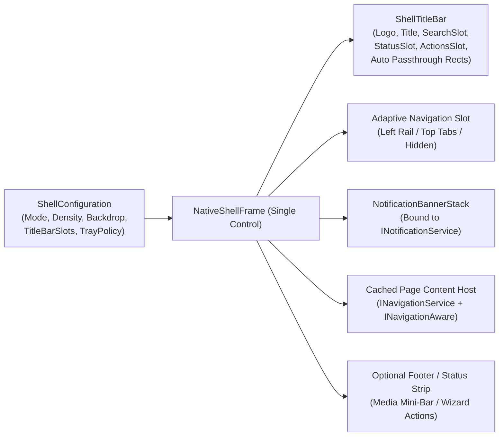

# NativeShellKit 2.0 — Native UI/UX & Design System Architecture

**Status:** Approved Design Blueprint (`docs/architecture-2.0`)  
**Target SDK Release:** `NativeShellKit.WinUI` & `NativeShellKit.DesignSystem` `0.2.0-alpha.2`  
**Stack:** WinUI 3, Windows App SDK `>= 2.6.4`, XAML-first `ResourceDictionary` & `TemplatedControl`, C# ViewModels/Services, Fluent 2 Design Language  
**Hard Constraints:** Zero Electron, zero HTML/CSS shells, zero mandatory WebView2; Windows 10 (19041+) and Windows 11 native parity.

---

## 1. Visual Architecture Philosophy & Audit of v1 Limitations

Direct inspection of `NativeShellKit.DesignSystem` (`0.1.0-alpha.1`/`alpha.2`) and `NativeShellKit.WinUI` revealed why HiberDesk had to partially bypass `NativeShellView` and why GhostCode/ED-Local-AI have not yet converged on shared UI:

| v1 Component / Resource | Audited v1 Defect | 2.0 Architectural Reconstruction |
| --- | --- | --- |
| `DesignSystemThemeResources.xaml` | Only 11 brushes & 3 styles; **no `HighContrast` `ThemeDictionary`**; no XAML typography, spacing, radius, or layer tokens (`DesignTokens.cs` only exposes C# `const double`). | Layered XAML token hierarchy (`Tokens.xaml` + `ThemeDictionaries` for `Light`, `Dark`, and `HighContrast` + `DensityCompact.xaml` / `DensityStandard.xaml` + `Motion.xaml`). |
| `StatusIndicatorControl.xaml.cs` | Hardcodes `Color.FromArgb(...)` in C# code-behind; **does not respond to Light/Dark theme switching or High Contrast**. | Pure `{ThemeResource NskStatus*}` brushes with `VisualStateManager` states and High Contrast solid border fallback. |
| All 8 v1 DesignSystem controls | **Zero `DependencyProperty` declarations** (raw CLR properties mutating named `x:Name` fields), breaking `{x:Bind}` and `{Binding}`; hardcoded English labels (`"Retry"`, `"Toggle theme"`). | 100% `DependencyProperty`-backed `TemplatedControl` (`Themes/Generic.xaml`) or composite `UserControl`, full `{x:Bind}` support, zero hardcoded English copy. |
| `CustomTitleBarControl.xaml` | Hardcoded `Padding="16,0,148,0"`, hardcoded `\uE756` icon (no app logo slot), **no `InputNonClientPointerSource` passthrough rect management** (forcing HiberDesk to write its own `UpdateTitleBarRegions()`). | `ShellTitleBar` with automatic `AppWindow.TitleBar.RightInset / scale`, automatic `Passthrough` rect registration for interactive slots (`SearchSlot`, `ActionsSlot`, `StatusSlot`), and custom `AppIcon` / `LogoSource`. |
| `NativeShellView.xaml` | Only supports **one** rigid layout (left `NavigationView` + `48px` title bar), no responsive breakpoints, no view caching, unsubscribed `Navigated` handler. | Unified **`NativeShellFrame`** supporting **5 shell variants** via `ShellConfiguration` + shared chrome slots, responsive breakpoints, cached pages, and clean `Unloaded` disposal. |

---

## 2. Semantic Design Token Architecture

All visual foundations live centrally in `NativeShellKit.DesignSystem/Themes/`:

```text
src/NativeShellKit.DesignSystem/Themes/
├── Generic.xaml                     # Default ControlTemplates for all TemplatedControls
├── DesignSystemThemeResources.xaml  # Master merged dictionary imported once in App.xaml
├── Tokens/
│   ├── SurfacesAndColors.xaml       # Light, Dark, HighContrast ThemeDictionaries (Nsk* brushes)
│   ├── Typography.xaml              # Fluent 2 TextBlock styles & FontSize/LineHeight tokens
│   ├── MetricsAndRadii.xaml         # Spacing, CornerRadius, Elevation, MinTouchTarget tokens
│   ├── DensityStandard.xaml         # Default desktop spacing (HiberDesk, GhostCode)
│   ├── DensityCompact.xaml          # Dense workflow spacing (ED-Local-AI, compact utilities)
│   └── Motion.xaml                  # Durations, ThemeTransitions, reduced-motion helpers
```

> **Backward Compatibility Rule:** Existing `0.1.0-alpha.2` resource keys (`NativeShellCardBackgroundBrush`, `NativeShellCardBorderBrush`, `NativeShellMutedTextBrush`, `NativeShellCardBorderStyle`, `NativeShellPageTitleStyle`, `NativeShellSectionTitleStyle`) are preserved as aliases pointing to the new `Nsk*` tokens throughout the `0.2.x` train so HiberDesk M12.5 pages continue working seamlessly while adopting 2.0 controls.

### 2.1 Layer & Surface Hierarchy

Designed for both Windows 11 Mica/Mica Alt translucency and opaque Windows 10 / Solid Fallback rendering:

| Token Key | Semantic Role | Light Value | Dark Value | HighContrast Value |
| --- | --- | --- | --- | --- |
| `NskSurfaceCanvasBrush` | Window base canvas (transparent when Mica active; solid fallback on Win10/Solid mode) | `#FFF3F5F8` | `#FF14171C` | `{ThemeResource SystemColorWindowColor}` |
| `NskSurfaceLayer1Brush` | Primary navigation & content layer over canvas | `#B8FFFFFF` | `#991C212A` | `{ThemeResource SystemColorWindowColor}` |
| `NskSurfaceCardBrush` | Standard elevated card (`Border`, `SettingsRow`, `MetricCard`) | `#EBFFFFFF` | `#DC202631` | `{ThemeResource SystemColorWindowColor}` |
| `NskSurfaceCardHoverBrush` | Interactive card pointer-over surface | `#F7FFFFFF` | `#EC272F3D` | `{ThemeResource SystemColorHighlightColor}` |
| `NskSurfaceElevatedBrush` | Flyouts, dialogs, floating media controls | `#FFFFFFFF` | `#FF262D3A` | `{ThemeResource SystemColorWindowColor}` |
| `NskSurfaceSubtleBrush` | Muted inset container, code strip, toolbar pill | `#120F172A` | `#1F94A3B8` | `{ThemeResource SystemColorWindowColor}` |
| `NskSurfaceSmokeBrush` | Modal backdrop scrim behind dialogs/overlays | `#4D000000` | `#73000000` | `#99000000` |
| `NskStrokeHairlineBrush` | Subtle section dividers and row separators | `#140F172A` | `#1F94A3B8` | `{ThemeResource SystemColorWindowTextColor}` |
| `NskStrokeCardBrush` | Default card outline (`1px`) | `#260F172A` | `#3394A3B8` | `{ThemeResource SystemColorWindowTextColor}` |
| `NskStrokeStrongBrush` | Focus/selected/active card outline | `{ThemeResource NskAccentDefaultBrush}` | `{ThemeResource NskAccentDefaultBrush}` | `{ThemeResource SystemColorHighlightColor}` |

### 2.2 Semantic Text & Status Palette (WCAG AA >= 4.5:1 Verified)

| Token Key | Light Value | Dark Value | HighContrast Mapping |
| --- | --- | --- | --- |
| `NskTextPrimaryBrush` | `#FF0F172A` | `#FFF1F5F9` | `SystemColorWindowTextBrush` |
| `NskTextSecondaryBrush` | `#FF475569` | `#FF9CA3AF` | `SystemColorWindowTextBrush` |
| `NskTextTertiaryBrush` | `#FF64748B` | `#FF6B7280` | `SystemColorGrayTextBrush` |
| `NskTextOnAccentBrush` | Computed contrast (`#FFFFFF` or `#0F172A`) | Computed contrast | `SystemColorHighlightTextBrush` |
| `NskStatusSuccessBgBrush` / `FgBrush` | `#1E059669` / `#FF047857` | `#2C10B981` / `#FF34D399` | Window / WindowText + 1px border |
| `NskStatusActiveBgBrush` / `FgBrush` | `#1E2563EB` / `#FF1D4ED8` | `#2C3B82F6` / `#FF60A5FA` | Highlight / HighlightText |
| `NskStatusWarningBgBrush` / `FgBrush` | `#22D97706` / `#FF9A3412` | `#2CF59E0B` / `#FFFBBF24` | Window / WindowText + 1px border |
| `NskStatusDangerBgBrush` / `FgBrush` | `#1EDC2626` / `#FFB91C1C` | `#2CEF4444` / `#FFF87171` | Window / WindowText + 1px border |
| `NskStatusOfflineBgBrush` / `FgBrush` | `#1A64748B` / `#FF475569` | `#2664748B` / `#FF94A3B8` | Window / GrayText + 1px border |

> **Ban on `Opacity` for Text Hierarchy:** Controls MUST NEVER use `Opacity="0.72"` on `TextBlock` for secondary text (as v1 `SettingsRowControl` and `StateViewControl` did). Always bind `Foreground="{ThemeResource NskTextSecondaryBrush}"` so High Contrast themes stay crisp and readable.

### 2.3 Typography Scale (`Segoe UI Variable` / `Segoe UI` Fallback)

| Style Key | FontFamily | Size (epx) | LineHeight (epx) | Weight | Usage |
| --- | --- | --- | --- | --- | --- |
| `NskCaptionTextStyle` | `Segoe UI Variable Small` | `12` | `16` | Regular | Metadata, timestamps, helper descriptions |
| `NskCaptionStrongTextStyle` | `Segoe UI Variable Small` | `12` | `16` | SemiBold | Status badge labels, shortcut hints |
| `NskBodyTextStyle` | `Segoe UI Variable Text` | `14` | `20` | Regular | Primary readable copy, list item titles |
| `NskBodyStrongTextStyle` | `Segoe UI Variable Text` | `14` | `20` | SemiBold | Settings row headers, card titles, primary labels |
| `NskSubtitleTextStyle` | `Segoe UI Variable Display` | `16` | `22` | SemiBold | Card group titles, dialog subtitles |
| `NskSectionTitleTextStyle` | `Segoe UI Variable Display` | `18` | `24` | SemiBold | Page section headings (`HeadingLevel="Level2"`) |
| `NskPageTitleTextStyle` | `Segoe UI Variable Display` | `24` | `32` | SemiBold | Page titles (`HeadingLevel="Level1"`) |
| `NskDisplayMetricTextStyle` | `Segoe UI Variable Display` | `28` | `36` | SemiBold | KPI / `MetricCard` numbers (`Typography.NumeralAlignment="Tabular"`) |
| `NskMonoCodeTextStyle` | `Cascadia Mono, Consolas` | `12.5` | `18` | Regular | Diff lines, file paths, job IDs, diagnostic logs |

### 2.4 Spacing, Density & Radius Scales

| Scale | Token Keys | Standard Density Values | Compact Density Values (`DensityCompact.xaml`) |
| --- | --- | --- | --- |
| **Spacing (`x:Double`)** | `NskSpaceXXS`, `XS`, `S`, `M`, `L`, `XL`, `XXL` | `4, 8, 12, 16, 24, 32, 48` | `2, 6, 8, 12, 16, 24, 32` |
| **Card Padding (`Thickness`)** | `NskCardPadding`, `NskPagePadding`, `NskRowPadding` | `16`, `24,16,24,24`, `16,12` | `12`, `16,12,16,16`, `12,8` |
| **Radii (`CornerRadius`)** | `NskRadiusControl`, `NskRadiusCard`, `NskRadiusOverlay`, `NskRadiusPill` | `4`, `8`, `12`, `999` | `4`, `6`, `10`, `999` |
| **Control Sizing** | `NskTitleBarHeight`, `NskMinInteractiveHeight` | `44`, `32` | `36`, `28` |

### 2.5 Accent Customization & Backdrop Fallback Rules

1. **Accent Modes (`AccentSourceMode`):**
   - `System` (follows Windows `UISettings.GetColorValue(UIColorType.Accent)` + live `ColorValuesChanged` listener)
   - `AppBrand` (product seed hex — e.g., HiberDesk Indigo `#2563EB`, GhostCode Cobalt `#2563EB` or Electric Teal `#0284C7`, ED-Local-AI Emerald `#059669`)
   - `Custom` (user-selected hex persisted via `ISettingsStore<T>`)
2. **Contrast Enforcement:** `WinUiThemeService.ComputePalette` enforces WCAG AA contrast (`>= 4.5:1`) for `NskTextOnAccentBrush` and `NskAccentTextBrush` on both Light and Dark surfaces. When Windows High Contrast (`AccessibilitySettings.HighContrast == true`) is active, **accent brush mutation is bypassed entirely** so Windows system High Contrast colors remain untouched.
3. **Backdrop Chain (`ShellBackdropKind`):**
   - `MicaBase` -> `MicaBackdrop { Kind = MicaKind.Base }` -> fallback to `DesktopAcrylicBackdrop` -> fallback to `NskSurfaceCanvasBrush` solid background.
   - `MicaAlt` -> `MicaBackdrop { Kind = MicaKind.BaseAlt }` -> same fallback chain.
   - `Acrylic` -> `DesktopAcrylicBackdrop` -> fallback to solid.
   - `Solid` -> `SystemBackdrop = null`, root background bound to `{ThemeResource NskSurfaceCanvasBrush}`.
   - **Automatic Degradation:** On Windows 10 (build `< 22000`), RDP/headless sessions, battery saver, or High Contrast mode, `TryApplyBackdrop` degrades gracefully to `Solid` without throwing and updates `ShellSurfaceMode` so `NskSurfaceCanvasBrush` renders opaque with crisp contrast.

### 2.6 Fluent Motion & Reduced Motion

| Motion Token | Duration | Easing | Usage |
| --- | --- | --- | --- |
| `NskMotionFast` | `83 ms` | Fast-out, Linear-in (`0.0, 0.0, 1.0, 1.0`) | Hover states, toggle flips, status badge transitions |
| `NskMotionStandard` | `167 ms` | Fluent Decelerate (`0.0, 0.0, 0.0, 1.0`) | Page content entrance (`EntranceNavigationTransitionInfo`), expanders, notification banner reveal |
| `NskMotionEmphasized` | `250 ms` | Fluent Standard (`0.8, 0.0, 0.2, 1.0`) | Pane open/collapse, dialog presentation |

`WinUiThemeService` exposes `bool IsAnimationsEnabled` (reading `UISettings.AnimationsEnabled`). When `false`, `NativeShellFrame` uses `SuppressNavigationTransitionInfo` and controls jump directly to target visual states.

---

## 3. Unified Shell Framework & Five Shell Variants

**Core Rule:** Build **ONE** shell control (`NativeShellFrame` in `NativeShellKit.WinUI`) parameterized by `ShellConfiguration` and composable XAML slots. **Do NOT build five separate shell frameworks.**



### 3.1 The Five Shell Variants (Unified on `NativeShellFrame`)

| Shell Variant (`ShellMode`) | Title Bar | Navigation Chrome | Density | Target Product(s) |
| --- | --- | --- | --- | --- |
| **`Dashboard`** | `44px` `ShellTitleBar` with app logo, centered `SearchSlot` (`Ctrl+K`), right `StatusSlot` + `ActionsSlot` | Responsive `NavigationView` (`Left` >= `1008px`, `LeftCompact` `641–1007px`, `LeftMinimal` <= `640px`), footer items (`Settings`) | `Standard` | **GhostCode** (Archive, Diff, DevTools, Cloud, Settings); standard desktop apps |
| **`ModuleHost`** | Same as `Dashboard` + module health/companion indicator pill in `StatusSlot` | `Dashboard` navigation + dynamic `IShellModule.GetNavigationItems()` + `ModuleCardBoundary`-wrapped dashboard widgets + optional bottom `CompactMediaBar` strip | `Standard` | **HiberDesk** (Overview, Workspaces, Browser Tabs, Files, Notes, Devices/Companion Hub, Settings) |
| **`CompactUtility`** | `36px` slim `ShellTitleBar` with compact badge + primary status indicator (no global search box) | Top `SelectorBar` / `TabView` strip (no left navigation rail); horizontal min-width `520px` | `Compact` | **ED-Local-AI** (Main WinUI & Practice Fast: Control / Progress / Logs compact workflow) |
| **`SinglePage`** | `40px` `ShellTitleBar` with title + optional help/theme action | Hidden (`PaneVisible = false`); single scrollable content region + optional sticky footer action bar | `Standard` | Diagnostics tools, setup wizards, standalone pairing/auth utilities |
| **`TrayFirst`** *(Behavioral modifier composable with `Dashboard`, `ModuleHost`, or `CompactUtility`)* | Inherits base variant when visible | Inherits base variant; integrates `ITrayService` lifecycle: starts hidden when `--background`/`--autostart`, hides to tray on close, warm-restores without rebuilding visual tree | Inherits base | **HiberDesk** (`--background`), **GhostCode** (background file watcher), background companions |

### 3.2 Shared Infrastructure Across All Five Variants

Regardless of `ShellMode`, every application shares the exact same:
- `IThemeService` (`Light` / `Dark` / `System` / `HighContrast` + Mica/Acrylic/Solid + Accent)
- `INavigationService` + view caching + `INavigationAware` + keyboard `Alt+Left` back navigation
- `IDialogService` (`DialogCoordinator` 2.0 with single-queue `ContentDialog` serialization)
- `INotificationService` -> `NotificationBannerStack` binding (auto-marshaled via `IUiDispatcher`)
- `IShellWindowService` (DPI-aware bounds persistence/restore with multi-monitor off-screen clamping, caption button theme sync, `InputNonClientPointerSource` passthrough rect recalculation on resize/DPI change)
- `ITrayService` (optional close-to-tray + Explorer `TaskbarCreated` icon recovery)

### 3.3 Per-App Visual Composition Profiles (Coherent, Not Clones)

| Product | Shell Mode | Density | Default Accent | Signature Composition |
| --- | --- | --- | --- | --- |
| **HiberDesk** | `ModuleHost` + `TrayFirst` | `Standard` | Indigo `#2563EB` (or System) | Global search in title bar, 7-section left rail, Overview KPI strip + `ModuleCardBoundary` ecosystem summary, Devices page with `CompactMediaBar` + BackThread/GhostCode companion hub |
| **GhostCode** | `Dashboard` + `TrayFirst` | `Standard` | Cobalt `#2563EB` (or System) | Dense code-centric archive browser, `NskMonoCodeTextStyle` side-by-side & unified diff viewer, 9-state `StatusBadge` cloud sync indicator in title bar, compact DevTools toolbar |
| **ED-Local-AI** *(Future)* | `CompactUtility` | `Compact` | Emerald `#059669` (or System) | `36px` slim title bar, 3-tab top `SelectorBar` (`Điều khiển` / `Tiến độ` / `Nhật ký`), tight form grids, persistent inline status banner, preserves 100% of compact single-window workflow |

---

## 4. Responsive Layout, High-DPI, High-Contrast & Accessibility Standards

1. **Responsive Breakpoints (`NativeShellFrame` VisualState Triggers):**
   - **Wide (`>= 1008 epx`):** `NavigationView` `Left` (`240px` pane), 3–4 column KPI `MetricStrip`, side-by-side split views (Archive + Diff, Devices + Companion).
   - **Medium (`641–1007 epx`):** `NavigationView` `LeftCompact` (`48px` icon rail), 2-column KPI grid, stacked cards.
   - **Compact (`<= 640 epx`):** `NavigationView` `LeftMinimal` (hamburger overlay), single-column stack, title bar search collapses into expandable button.
2. **High-DPI (`100%`, `125%`, `150%`, `175%`, `200%`, `250%`):**
   - Never hardcode pixel widths for title bar caption buttons; always compute `RightInset / XamlRoot.RasterizationScale` on `Loaded`, `SizeChanged`, and `XamlRoot.Changed`.
   - Convert all interactive title bar element rects via `TransformToVisual(root)` multiplied by `RasterizationScale` before passing to `InputNonClientPointerSource.SetRegionRects(NonClientRegionKind.Passthrough, ...)`.
   - Never rasterize UI icons as bitmaps; use Segoe Fluent Icons (`FontIcon`) and vector `PathIcon` so icons remain razor-sharp at 250% scaling.
3. **High-Contrast & Keyboard / UIA Accessibility:**
   - Every control ships explicit `HighContrast` dictionary brushes and visible `1px` borders on cards, badges, and interactive rows.
   - Every interactive control supports full `Tab` / `Shift+Tab` / `Arrow` / `Enter` / `Escape` navigation, visible focus visuals (`UseSystemFocusVisuals="True"`), `AutomationProperties.Name`, `AutomationProperties.HeadingLevel` on titles, and `AutomationProperties.LiveSetting="Polite"` (or `"Assertive"` for errors) on status banners and delivery feedback.
   - Global keyboard accelerators supported centrally by `NativeShellFrame`: `Ctrl+K` (focus SearchSlot), `Alt+Left` (GoBack), `Ctrl+,` (navigate to `Settings` route if registered).
